<div align="center">



<br>


</div>

---

## `> whoami`

```console
kd@khemendra-labs:~$ cat about.txt

name       Khemendra Singh Khangarot (Kd)
base       Delhi, India
studying   MCA @ JIMS Rohini  ->  graduating Sep 2027
           Diploma in Cyber Security @ Craw Security, Saket
prior      BCA @ Manipal University (2024)
works on   threat intelligence, forensics tooling, endpoint security, backend systems
style      local-first. deterministic. explainable.

kd@khemendra-labs:~$ _
```

I build security tools that tell you **why** they made a decision, and that run on your own machine instead of someone else's cloud.

---

## `> ./featured`

<table>
<tr>
<td width="50%" valign="top">

### ♾️ [Animisha](https://github.com/khemendra-labs/Animisha)
**Endpoint firewall & network monitor for Windows and Linux.**

Shows which program owns every connection, verifies its signature and SHA-256, and enforces an 8-tier rule engine where the first match always wins. High and Critical alerts go to Telegram.


[**Download v1.0 →**](https://github.com/khemendra-labs/Animisha/releases/tag/v1.0)

</td>
<td width="50%" valign="top">

### ⚖️ Nyaya AI Platform
**Offline-first legal intelligence.**

A retrieval-augmented platform for Indian criminal law (BNS, BNSS, BSA) that answers with citations and runs fully offline. Telegram was the first client. Web, mobile, desktop, CLI and REST come next on a clean, hexagonal core.


*In active development.*

</td>
</tr>

### 🧬 More from the lab

- **ACIS** — Autonomous Cyber Immune System
- **ShellSock**
- **Virtualized Security Lab**
- **VoidPanel** — part of the team building an open-source server control panel at **VoidOnyx LLP**

</td>
</tr>
</table>

---

## `> cat stack.txt`

<div align="center">


</div>

---

## `> ls ~/focus`

| | Area | What it means in practice |
|:-:|---|---|
| 🛡️ | **Endpoint security** | Process attribution, signature and hash verification, firewall policy engines |
| 🔎 | **Threat intelligence** | Feed ingestion, MITRE ATT&CK mapping, indicator matching |
| 🧫 | **Digital forensics** | Malware triage, cloud log analysis, evidence handling |
| 🤖 | **Applied AI** | Local LLMs, RAG with citations, anomaly detection |
| ⚙️ | **Backend systems** | APIs, queues, storage and clean architecture |

---

## `> cat principles.md`

- **Local first.** Your data stays on your machine unless you choose otherwise.
- **Deterministic over clever.** Same input, same decision, and you can see which rule decided it.
- **Explain everything.** An alert without evidence is just noise.
- **Test the boring parts.** Security tools fail in the edge cases.

---

## `> ls ~/certs`

<div align="center">


</div>

---

## `> ./connect`

<div align="center">

[](https://github.com/khemendra-labs/Animisha/releases/tag/v0.3.0)
[](https://github.com/khemendra-labs)
[](https://in.linkedin.com/in/khemendrasinghkhangarot)

<br>

<sub>Open to internships and projects in cybersecurity.</sub>

</div>
